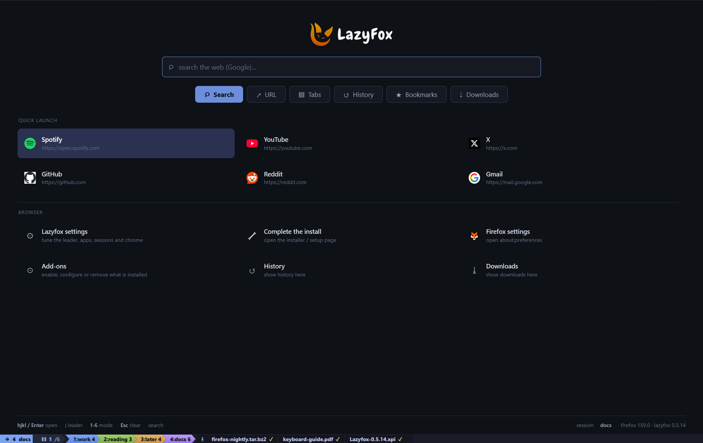

<p align="center">
  
</p>

Lazyfox is Firefox with the browser UI removed.

No tab strip, no address bar, no menus. Pages get the whole window. A thin bar
along the bottom shows the current session, your place in the tab list, running
downloads, and the key the leader is waiting for.

Press `;` and a small grid of bindings appears. Press the key for what you want,
and it happens. The grid is a reminder, never a confirmation step.



## What you get

- **Command center.** New tabs open on a search box over open tabs, history,
  bookmarks and downloads, with quick-launch tiles for the sites you use.
  `1`–`6` switch modes, `j`/`k` move, `Enter` opens.
- **Link hints.** Every visible link, button and menu item gets a short label.
  Type the label to follow it.
- **Find.** Live match count, matches in reading order, and a yank mode that
  copies text. It reads shadow roots and text split across elements.
- **Sessions.** Named snapshots of a window, splits included. Switching
  sessions replaces the whole window; the current one keeps saving itself.
- **Split view.** Two tabs side by side, addressable from the keyboard.
- **Isolated tabs.** A tab in its own container that wipes its cookies and
  storage when it closes.
- **Reader.** `;R` extracts the article and shows it in place, with your
  typography and the normal keys still working.
- **Dark mode.** Off by default. Turn it on globally or per site; the settings
  page has the same controls as the keyboard.

## Install

Lazyfox is two pieces: the add-on, and a small profile patch that removes
Firefox's own chrome. Extensions cannot touch the browser window, so that patch
comes from an installer.

**From addons.mozilla.org:** install the add-on, open its home page and choose
**Complete the install**. The page picks the installer for your platform and
channel; run it. It finds your profiles, writes the chrome files, merges
Lazyfox's preferences, installs the add-on and asks for administrator rights
once for the autoconfig loader. Restart Firefox and the page turns green.

**From the releases page:** one binary per platform, with no runtime to
install. It opens a native window, lists the Firefox profiles it found, shows
what it will write or remove, and only then acts. There are one-line wrappers
as well:

```sh
# macOS / Linux
curl -fsSL https://github.com/YELrhilassi/lazyfox/releases/latest/download/install.sh | sh
```

```powershell
# Windows
irm https://github.com/YELrhilassi/lazyfox/releases/latest/download/install.ps1 | iex
```

The installer needs administrator rights for one file: the autoconfig loader in
the Firefox installation directory. Everything else lives in the profile.
Bookmarks, history, passwords and other add-ons are left alone, and any file it
replaces is backed up first. The same binary removes Lazyfox again.

## Keys

| Key | Action |
| --- | --- |
| `;` | open the leader menu (which-key) |
| `;n` / `;x` | new tab / close tab |
| `;v` / `;V` | reopen closed tab / recently closed tabs |
| `;c` / `;a` | duplicate tab / alternate to the last used tab |
| `;j` / `;k` | next tab / previous tab |
| `;1`–`;9` | go to tab by position; past nine, `;11` means tab 11 |
| `;$` | go to the last tab |
| `;t` | tab switcher: type to filter, numbers jump, `h`/`l` move, `x` closes |
| `;r` / `;g` / `;l` | reload / back / forward |
| `;G` / `;L` | back / forward through the history stack |
| `;m` | mute tab |
| `;f` | link hints |
| `;o` / `;O` | open a URL in a new tab / in this tab |
| `;s` / `;S` | search the web in a new tab / in this tab |
| `;h` / `;b` / `;d` | history / bookmarks / downloads |
| `;i` | focus the first input |
| `;P` | sessions |
| `;Q` | save the session and quit |
| `;W` | window and layout menu: resize, zen, splits, panes, tab order |
| `;W` then &#124; | split the current tab side by side |
| `;C` | screenshot menu: `f` full page, `v` visible area |
| `;Z` | zoom menu: `i` in, `o` out, `r` reset |
| `;K` | address menu: `c` copy the URL, `e` edit it |
| `;F` / `;B` | next / previous scroll region |
| `;/` | find in page |
| `;R` | reader mode |
| `;Y` | theme menu: `d` this site, `g` default, `e` engine, `p` palette, `x` reset |
| `;N` | stealth tab, wiped when it closes |
| `;T` | diagnostics and performance |
| `;q` | toggle the which-key overlay |
| `;D` | dismiss the download notification |
| `;?` | searchable keybindings help |

The leader is `;` by default; it can be changed in settings. `j`/`k`/`d`/`u`,
`gg` and `G` scroll the page or the focused scroll region.

## How it works

- **`src/extension/`** is a regular WebExtension: content scripts, background,
  popups, hints, the command center. It runs everywhere Firefox lets an
  extension run, and it is what AMO ships.
- **`src/chrome/`** is privileged JavaScript loaded through Firefox's
  autoconfig hook. It hides the tab strip and toolbar, draws the window status
  bar, and owns the leader key on pages where extensions are not allowed. The
  hook exists because nothing in the WebExtension API can remove browser chrome.
- **`core/`** is a Go core compiled to WebAssembly and embedded in both
  bundles. The keymap, chord resolution, hint ordering, scrolling and the
  status bar model live there, so both halves agree on what a key means and the
  logic is tested once, in Go.

The chrome helper has no `browser.*` API, so the extension and the helper talk
through a hidden relay tab and a native messaging host. The installer writes
the chrome files and `user.js` into the profile, installs the add-on, and copies
the autoconfig loader into the Firefox installation.

## Repository layout

```
src/extension/   add-on: content scripts, background, popups, command center
src/chrome/      privileged window code: chrome removal, status bar, leader
src/shared/      code both halves import: config, popups, protocol, status bar
core/            Go core, compiled to wasm and embedded in both bundles
installer/       Go installer with a native window, and its build payload
native-host/     Go native messaging host
scripts/         build, release, e2e and packaging tools
dist/            built add-on and chrome files (committed)
docs/            architecture, development, testing and release notes
```

Two choices shape most of the code above. The keymap lives in the Go core
because the same keys have to work in two contexts that cannot share
JavaScript. And `dist/` plus `installer/bin/` are committed, because a download
must work without a toolchain; `npm run check` hashes them against the source,
so a stale artifact fails the build instead of shipping.

## Development

Node and Go are required. `npm install` checks both.

```sh
npm install          # dependencies and toolchain check
npm run build        # wasm, bundles, xpi, installer binaries
npm run dev-install  # build, then install into Nightly or Developer Edition
npm run verify       # typecheck and tests
npm run ci           # the checks CI runs, locally
```

Browser tests drive a real Firefox over WebDriver BiDi:

```sh
npm run e2e                        # every suite
node scripts/e2e/main.ts --suite content
node scripts/e2e/screenshots.ts    # regenerate docs/img/*.png
```

Development builds are unsigned and need Nightly or Developer Edition.
Releases use the AMO-signed add-on on stable Firefox: `npm run submit` uploads
a version, and after AMO signs it, `npm run ship` merges to `master`, embeds the
signed xpi, tags the release and publishes it.

More detail: [ARCHITECTURE](docs/ARCHITECTURE.md),
[DEVELOPING](docs/DEVELOPING.md), [TESTING](docs/TESTING.md),
[RELEASING](docs/RELEASING.md), [DARK-MODE](docs/DARK-MODE.md),
[READER](docs/READER.md), [UPDATES](docs/UPDATES.md),
[UPGRADING](docs/UPGRADING.md), [MESSAGING](docs/MESSAGING.md),
[AMO listing](docs/AMO-LISTING.md), [third-party code](docs/THIRD-PARTY.md).

## Limits

- Lazyfox depends on Firefox internals for the chrome layer. A Firefox update
  can break it and may need a matching Lazyfox release.
- Firefox keeps `Ctrl+Tab`; use `;t` or `;j`/`;k`.
- Where neither half can run the leader, `Ctrl+Alt+Space` still opens the menu.

## License

MIT
